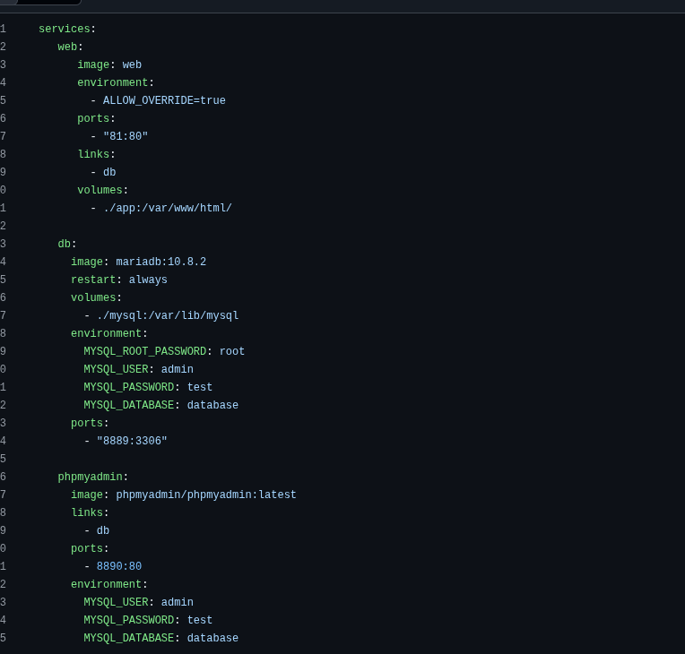

# Laboratorio: Firewall

## Requisitos previos

- Máquina GNU/Linux: portátil, máquina virtual, o PC laboratorio (Entrar con credencial LDAP, solo usar lsi si es necesario, mediante el comando `su - lsi`).
- Editor de código. En Visual Studio Code, pulsando ctrl+mayus+v renderiza este archivo de manera amigable (Sobre todo para imágenes).
- Repositorio GitHub de asignatura: puedes subir los programas desarrollados en el laboratorio.
- Cuenta Google Cloud.

## Firewall Google Cloud

En este laboratorio desplegaréis vuestro sistema web en el servidor remoto de Google Cloud para aprender a configurar el acceso al mismo a través del firewall que provee Google Cloud por defecto. Para desplegar el proyecto web en el servidor remoto hay que instalar Docker y Docker Compose.

En el servidor, por SSH:

```bash
sudo apt update
sudo apt install -y docker.io docker-compose-v2
sudo usermod -aG docker $USER
```

Hay que cerrar la sesión SSH y volver a entrar para que el grupo `docker` valga. El paquete `docker-compose-v2` no crea el comando `docker-compose`; se usa `docker compose`.

Clonad el proyecto web en el servidor de Google Cloud (una vez establecida la conexión SSH): 

```bash
git clone https://github.com/mikel-egana-aranguren/docker-lamp.git
```

Construid la imagen web:

```bash
docker build -t="web" .
```

Desplegad la aplicación mediante Docker Compose:

```bash
docker compose up
```

Para poder acceder a nuestro proyecto, cargar los datos mediante phpMyAdmin y ver la página web, tenemos que abrir ciertos puertos.

> ¿En qué puertos escucha nuestro proyecto? (Pista: `netstat`).

**Respuesta:** Con los contenedores en marcha, `sudo netstat -tulpn`. 
Si miramos en el proyecto que hemos clonado vemos los puertos de cada parte:


El `docker-compose.yml` publica el **81** (web), el **8890** (phpMyAdmin) y el **8889** (MariaDB). 


> ¿Cómo se pueden abrir esos puertos en Google Cloud? (Pistas: red de VPC, etiqueta `http-server`, `0.0.0.0/0`).

**Respuesta:** La máquina tiene que llevar la etiqueta de red `http-server`. En `VPC network` > `Firewall` > `Create firewall rule`: dirección `Ingress`, acción `Allow`, destino la etiqueta `http-server`, origen `0.0.0.0/0`, TCP puertos `81,8890`.


> ¿Cómo cerrarías los puertos 80 y 443 al tráfico entrante?

**Respuesta:** Las reglas `default-allow-http` y `default-allow-https` abren esos puertos. Una denegación con prioridad más alta (número más bajo) gana a esas reglas, que van en 1000. Regla nueva: `Ingress`, `Deny`, prioridad `900`, origen `0.0.0.0/0`, TCP puertos `80,443`.

Además del tráfico entrante, en un firewall se puede bloquear el tráfico saliente.

> ¿Cómo impedirías el tráfico saliente a la página [https://en.wikipedia.org](https://en.wikipedia.org/) desde tu servidor de Google Cloud? (Pistas: `wget`, `ping`).

**Respuesta:** Desde el servidor obtenemos la dirección y se comprueba que responde:

Forzamos a que nos devuelva la IPV4
```bash
getent ahostsv4 en.wikipedia.org
```
Devuelve:
185.15.58.224   STREAM dyna.wikimedia.org
185.15.58.224   DGRAM  
185.15.58.224   RAW    

Regla nueva: dirección `Egress`, acción `Deny`, destino las direcciones que haya devuelto `getent`, TCP puerto `443`. 

Después el mismo `wget` tiene que fallar:

```bash
wget -q --spider https://en.wikipedia.org
```

Esas direcciones cambian, así que la regla vale para las que salgan en ese momento.

Por último, se puede bloquear el tráfico desde una dirección concreta.

> ¿Cómo impedirías el tráfico entrante en el puerto 8890 desde tu IP actual? (Pista: «What is my IP?»).

**Respuesta:** El puerto **8890** es phpMyAdmin. Antes lo abrimos a `0.0.0.0/0`, así que cualquiera puede entrar. Ahora hay que denegar **solo nuestra IP pública**, la que ve internet, no la `10.x` de la máquina de Google (esa es interna). Sale en [https://ifconfig.me](https://ifconfig.me) o con:

```bash
curl -4 ifconfig.me
```

Esa dirección va como origen `IP/32`.

Hay que volver a configurar el phonebook-vpc
En `VPC network` > `Firewall` > `Create firewall rule`:

- Dirección: `Ingress` (tráfico hacia el servidor).
- Acción: `Deny`.
- Prioridad: `900`. En Google Cloud gana el número más bajo. Las reglas de permiso suelen ir en 1000, así que 900 se aplica primero y nos bloquea a nosotros.
- Origen: `IP/32`.
- Destino: etiqueta `http-server` (la de la VM).
- Protocolo: TCP, puerto `8890`.

El resto de IPs no coinciden con esa regla y siguen usando la de permitir. Desde nuestro navegador `http://34.175.153.93:8890/` deja de abrir; desde otra red (VPN) sigue funcionando en teoría.

## IPTables

**IPTables** es un módulo perteneciente al kernel de Linux que permite actuar como firewall, ya que se encarga de filtrar los paquetes de datos que entran y salen de la máquina. IPTables funciona mediante reglas que tendremos que definir en función de lo que queramos hacer. Por defecto, las reglas definidas no son persistentes; esto es, al reiniciar el sistema se borran.

Para evitar tener que introducir una y otra vez las mismas reglas, se pueden guardar en un fichero mediante el siguiente comando:

```bash
sudo iptables-save > /home/asier/fichero
```

Tras reiniciar la máquina, se pueden recuperar mediante:

```bash
sudo iptables-restore < /home/asier/fichero
```

Si quisiéramos que la restauración de reglas se hiciera de manera automática cada vez que se reiniciara el sistema, podríamos crear un script que se ejecutara al iniciar la máquina o modificar la configuración de red para que, al configurar las conexiones, se restauraran automáticamente las reglas de IPTables.

Definid las reglas necesarias para conseguir lo siguiente:

> Que vuestro servidor de Google Cloud solo acepte conexiones SSH desde el servidor de Google Cloud de otro alumno y desde vuestra máquina local.

**Solución:** En ambos casos se necesita la IP de origen que ve el servidor: la IP pública del otro servidor y la IP pública de nuestra máquina local (si esta sale a Internet a través de un router, será la IP pública del router). Sustituid los valores de ejemplo por esas IP. Insertad las reglas antes de las reglas generales de `INPUT` y mantened abierta la sesión SSH actual mientras comprobáis una segunda conexión:


curl -4 https://ifconfig.me para obtener la IP de mi máquina local

```bash
# Crea una cadena independiente para filtrar las conexiones SSH.
sudo iptables -N SSH_FILTER
# Permite el tráfico de conexiones ya establecidas o relacionadas.
sudo iptables -A SSH_FILTER -m conntrack --ctstate ESTABLISHED,RELATED -j ACCEPT
# Permite nuevas conexiones SSH desde el otro servidor autorizado.
sudo iptables -A SSH_FILTER -s IP_PUBLICA_OTRO_SERVIDOR/32 -p tcp --dport 22 -j ACCEPT
# Permite nuevas conexiones SSH desde la máquina local autorizada.
sudo iptables -A SSH_FILTER -s IP_PUBLICA_MAQUINA_LOCAL/32 -p tcp --dport 22 -j ACCEPT
# Bloquea el resto de conexiones TCP dirigidas al puerto SSH (22).
sudo iptables -A SSH_FILTER -p tcp --dport 22 -j DROP
# Aplica el filtro al tráfico SSH antes que las reglas generales de INPUT.
sudo iptables -I INPUT 1 -p tcp --dport 22 -j SSH_FILTER
```

La regla de Google Cloud también debe permitir SSH desde esos orígenes; el firewall de la VM y el firewall de VPC son filtros distintos.

> Instalad un servicio FTP en vuestro servidor de Google Cloud y configuradlo para que solo acepte conexiones FTP desde máquinas de la red de `ehu.eus`.

**Solución:** Por ejemplo, instalad `vsftpd` y configurad el modo pasivo con un rango fijo de puertos:

```bash
sudo apt update
sudo apt install -y vsftpd
sudo nano /etc/vsftpd.conf
```

Añadid o ajustad estas opciones en `/etc/vsftpd.conf`:

```ini
listen=YES
listen_ipv6=NO
anonymous_enable=NO
local_enable=YES
write_enable=YES
pasv_enable=YES
pasv_min_port=30000
pasv_max_port=30100
```

Reiniciad el servicio:

```bash
sudo systemctl restart vsftpd
```

Obtened de la documentación de red de la UPV/EHU los CIDR vigentes de `ehu.eus`; no se deben deducir a partir de una sola dirección DNS. Cread una cadena que solo admita esos orígenes y conectadla al principio de `INPUT`, antes de cualquier regla general:

```bash
sudo iptables -N FTP_FILTER
sudo iptables -A FTP_FILTER -p tcp -s CIDR_EHU --match multiport --dports 21,30000:30100 -j ACCEPT
sudo iptables -A FTP_FILTER -p tcp --match multiport --dports 21,30000:30100 -j DROP
sudo iptables -I INPUT 1 -p tcp --match multiport --dports 21,30000:30100 -j FTP_FILTER
```

Repetid la regla `ACCEPT` dentro de `FTP_FILTER` para cada rango EHU, siempre antes de la regla `DROP`. Abrid también esos puertos en el firewall de VPC, restringidos a los mismos CIDR. FTP sin TLS transmite credenciales sin cifrar; para un servicio real es preferible configurar FTPS o SFTP.

> Que vuestro servidor de Google Cloud no acepte conexiones HTTP (solo HTTPS).

**Solución:** Denegad el puerto TCP 80 entrante y permitid el 443. Si se insertan reglas en la cadena `INPUT`, hacedlo antes de otras reglas generales que acepten tráfico:

```bash
sudo iptables -I INPUT 1 -p tcp --dport 80 -j DROP
sudo iptables -I INPUT 1 -p tcp --dport 443 -j ACCEPT
```

En Google Cloud, quitad cualquier regla de entrada que permita el puerto 80 y mantened una regla de permiso para el 443. La aplicación o el proxy web también debe estar configurado para servir HTTPS.

> Que en vuestra máquina local no se puedan hacer conexiones salientes a Twitter, Facebook ni YouTube.

**Solución:** `iptables` filtra direcciones IP, no nombres de dominio. Se puede usar `ipset` con las direcciones resueltas para los dominios del servicio y bloquear HTTP, HTTPS y QUIC (HTTP/3):

```bash
sudo apt install -y ipset
sudo ipset create social hash:ip family inet -exist

for domain in twitter.com x.com t.co facebook.com fb.com youtube.com youtu.be googlevideo.com ytimg.com; do
	getent ahostsv4 "$domain" | awk '{print $1}' | sort -u | while read -r ip; do
		sudo ipset add social "$ip" -exist
	done
done

sudo iptables -I OUTPUT 1 -p tcp -m multiport --dports 80,443 -m set --match-set social dst -j REJECT
sudo iptables -I OUTPUT 1 -p udp --dport 443 -m set --match-set social dst -j REJECT
```

Esta lista es solo una demostración: los servicios usan muchos subdominios, CDN e IP que cambian, y algunas direcciones pueden ser compartidas con otros sitios. Por tanto, resolver unos pocos nombres no garantiza un bloqueo completo y puede bloquear servicios ajenos. Para un bloqueo fiable, usad un filtro DNS/proxy que admita esos dominios y sus subdominios, o mantened actualizado el conjunto de direcciones. Las reglas de `iptables` y el conjunto `ipset` también deben restaurarse al arrancar; guardar solo `iptables` no guarda el contenido de `ipset`.
