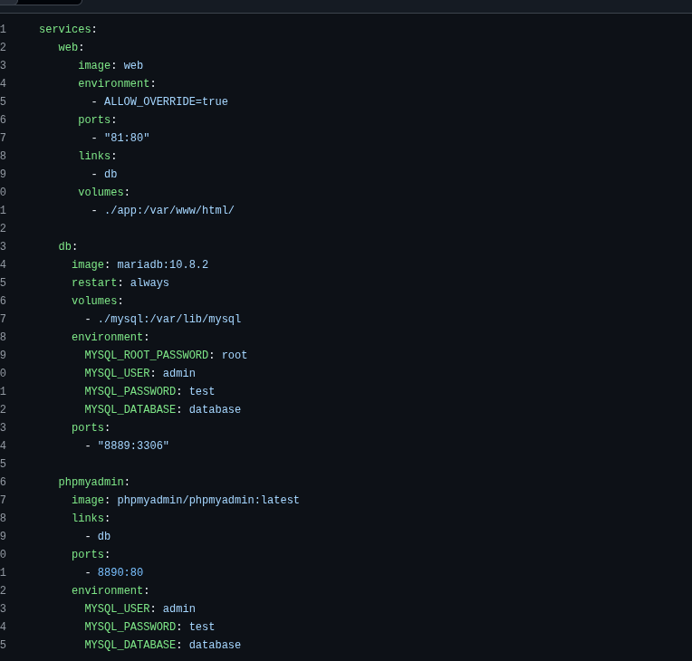

# Laboratorio: Firewall

## Requisitos previos

- Máquina GNU/Linux: portátil, máquina virtual, o PC laboratorio (Entrar con credencial LDAP, solo usar lsi si es necesario, mediante el comando `su - lsi`).
- Editor de código. En Visual Studio Code, pulsando ctrl+mayus+v renderiza este archivo de manera amigable (Sobre todo para imágenes).
- Repositorio GitHub de asignatura: puedes subir los programas desarrollados en el laboratorio.
- Cuenta Google Cloud.

## Firewall Google Cloud

En este laboratorio desplegaréis vuestro sistema web en el servidor remoto de Google Cloud para aprender a configurar el acceso al mismo a través del firewall que provee Google Cloud por defecto. Para desplegar el proyecto web en el servidor remoto hay que instalar Docker y Docker Compose.

En el servidor, por SSH:

```bash
sudo apt update
sudo apt install -y docker.io docker-compose-v2
sudo usermod -aG docker $USER
```

Hay que cerrar la sesión SSH y volver a entrar para que el grupo `docker` valga. El paquete `docker-compose-v2` no crea el comando `docker-compose`; se usa `docker compose`.

Clonad el proyecto web en el servidor de Google Cloud (una vez establecida la conexión SSH): 

```bash
git clone https://github.com/mikel-egana-aranguren/docker-lamp.git
```

Construid la imagen web:

```bash
docker build -t="web" .
```

Desplegad la aplicación mediante Docker Compose:

```bash
docker compose up
```

Para poder acceder a nuestro proyecto, cargar los datos mediante phpMyAdmin y ver la página web, tenemos que abrir ciertos puertos.

> ¿En qué puertos escucha nuestro proyecto? (Pista: `netstat`).

**Respuesta:** Con los contenedores en marcha, `sudo netstat -tulpn`. 
Si miramos en el proyecto que hemos clonado vemos los puertos de cada parte:


El `docker-compose.yml` publica el **81** (web), el **8890** (phpMyAdmin) y el **8889** (MariaDB). 


> ¿Cómo se pueden abrir esos puertos en Google Cloud? (Pistas: red de VPC, etiqueta `http-server`, `0.0.0.0/0`).

**Respuesta:** La máquina tiene que llevar la etiqueta de red `http-server`. En `VPC network` > `Firewall` > `Create firewall rule`: dirección `Ingress`, acción `Allow`, destino la etiqueta `http-server`, origen `0.0.0.0/0`, TCP puertos `81,8890`.


> ¿Cómo cerrarías los puertos 80 y 443 al tráfico entrante?

**Respuesta:** Las reglas `default-allow-http` y `default-allow-https` abren esos puertos. Una denegación con prioridad más alta (número más bajo) gana a esas reglas, que van en 1000. Regla nueva: `Ingress`, `Deny`, prioridad `900`, origen `0.0.0.0/0`, TCP puertos `80,443`.

Además del tráfico entrante, en un firewall se puede bloquear el tráfico saliente.

> ¿Cómo impedirías el tráfico saliente a la página [https://en.wikipedia.org](https://en.wikipedia.org/) desde tu servidor de Google Cloud? (Pistas: `wget`, `ping`).

**Respuesta:** Desde el servidor obtenemos la dirección y se comprueba que responde:

Forzamos a que nos devuelva la IPV4
```bash
getent ahostsv4 en.wikipedia.org
```
Devuelve:
185.15.58.224   STREAM dyna.wikimedia.org
185.15.58.224   DGRAM  
185.15.58.224   RAW    

Regla nueva: dirección `Egress`, acción `Deny`, destino las direcciones que haya devuelto `getent`, TCP puerto `443`. 

Después el mismo `wget` tiene que fallar:

```bash
wget -q --spider https://en.wikipedia.org
```

Esas direcciones cambian, así que la regla vale para las que salgan en ese momento.

Por último, se puede bloquear el tráfico desde una dirección concreta.

# TODO: mirar de aqui en adelante
> ¿Cómo impedirías el tráfico entrante en el puerto 8890 desde tu IP actual? (Pista: «What is my IP?»).

**Respuesta:** La IP pública sale en [https://ifconfig.me](https://ifconfig.me) o con `curl -4 ifconfig.me`. Regla: `Ingress`, `Deny`, prioridad `900`, origen `TU_IP/32`, destino la etiqueta `http-server`, TCP puerto `8890`. El resto de direcciones sigue entrando por la regla de permiso.

## IPTables

**IPTables** es un módulo perteneciente al kernel de Linux que permite actuar como firewall, ya que se encarga de filtrar los paquetes de datos que entran y salen de la máquina. IPTables funciona mediante reglas que tendremos que definir en función de lo que queramos hacer. Por defecto, las reglas definidas no son persistentes; esto es, al reiniciar el sistema se borran.

Para evitar tener que introducir una y otra vez las mismas reglas, se pueden guardar en un fichero mediante el siguiente comando:

```bash
sudo iptables-save > /home/user/fichero
```

Tras reiniciar la máquina, se pueden recuperar mediante:

```bash
sudo iptables-restore < /home/user/fichero
```

Si quisiéramos que la restauración de reglas se hiciera de manera automática cada vez que se reiniciara el sistema, podríamos crear un script que se ejecutara al iniciar la máquina o modificar la configuración de red para que, al configurar las conexiones, se restauraran automáticamente las reglas de IPTables.

Definid las reglas necesarias para conseguir lo siguiente:

> Que vuestro servidor de Google Cloud solo acepte conexiones SSH desde el servidor de Google Cloud de otro alumno y desde vuestra máquina local.

> Instalad un servicio FTP en vuestro servidor de Google Cloud y configuradlo para que solo acepte conexiones FTP desde máquinas de la red de `ehu.eus`.

> Que vuestro servidor de Google Cloud no acepte conexiones HTTP (solo HTTPS).

> Que en vuestra máquina local no se puedan hacer conexiones salientes a Twitter, Facebook ni YouTube.
